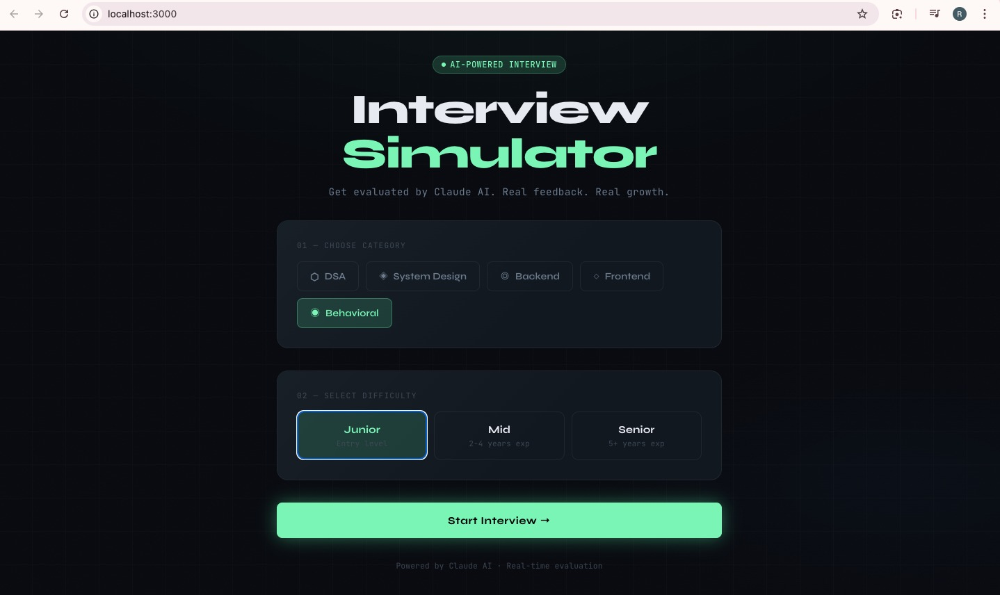
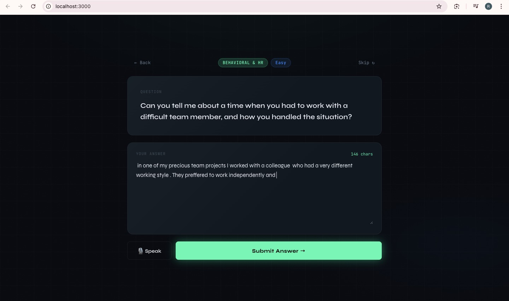
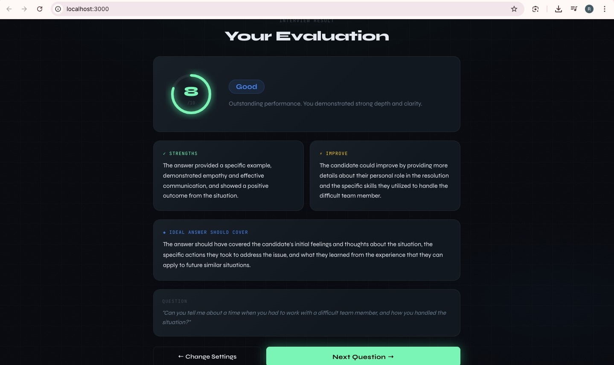

# AI Interview Simulator

A full-stack AI-powered mock interview platform that generates dynamic technical interview questions and evaluates user responses with real-time scoring and structured feedback.



## Features

- AI-generated questions across 5 categories — DSA, System Design, Backend, Frontend, Behavioral
- Real-time answer evaluation with score out of 10
- Structured feedback — strengths, improvements, ideal answer points
- Voice input support via Web Speech API
- 3 difficulty levels — Junior, Mid, Senior
- Clean dark UI with animated score ring




## Tech Stack

| Layer | Technology |
|-------|-----------|
| Frontend | React, Axios |
| Backend | Python, Flask, Flask-CORS |
| AI Model | Llama 3.3 70B via Groq API |
| Voice | Web Speech API |

## Project Structure
```
ai-interview-system/
├── backend/
│   ├── app.py
│   ├── ai_engine.py
│   └── requirements.txt
├── frontend/
│   └── src/
│       ├── App.js
│       ├── App.css
│       └── components/
│           ├── LandingScreen.js
│           ├── InterviewScreen.js
│           └── FeedbackScreen.js
├── screenshots/
└── README.md
```

## Getting Started

### Prerequisites
- Python 3.8+
- Node.js 16+
- Free Groq API key from [console.groq.com](https://console.groq.com)

### Backend Setup
```bash
cd backend
python3 -m venv venv
source venv/bin/activate
pip install -r requirements.txt
```

Create a `.env` file in the `backend/` folder:
```
GROQ_API_KEY=your_groq_api_key_here
```

Run the backend:
```bash
python app.py
```

### Frontend Setup
```bash
cd frontend
npm install
npm start
```

Open [http://localhost:3000](http://localhost:3000)

## Usage

1. Select a category and difficulty level
2. Click **Start Interview**
3. Read the AI-generated question
4. Type your answer or use **🎙 Speak** for voice input
5. Click **Submit Answer** to get AI evaluation
6. Review your score, strengths, and improvement areas


